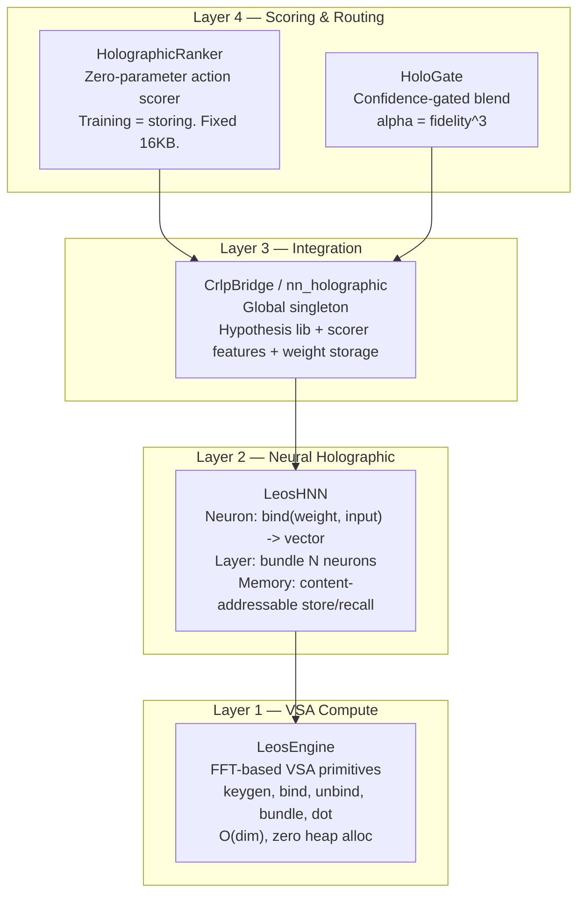
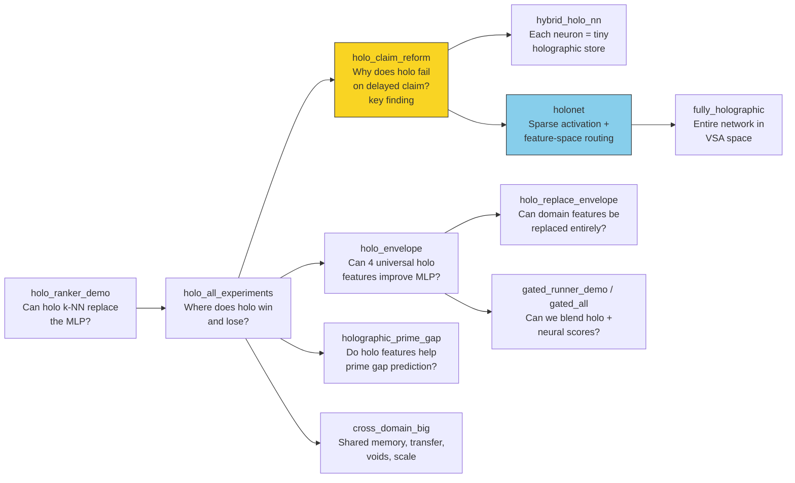
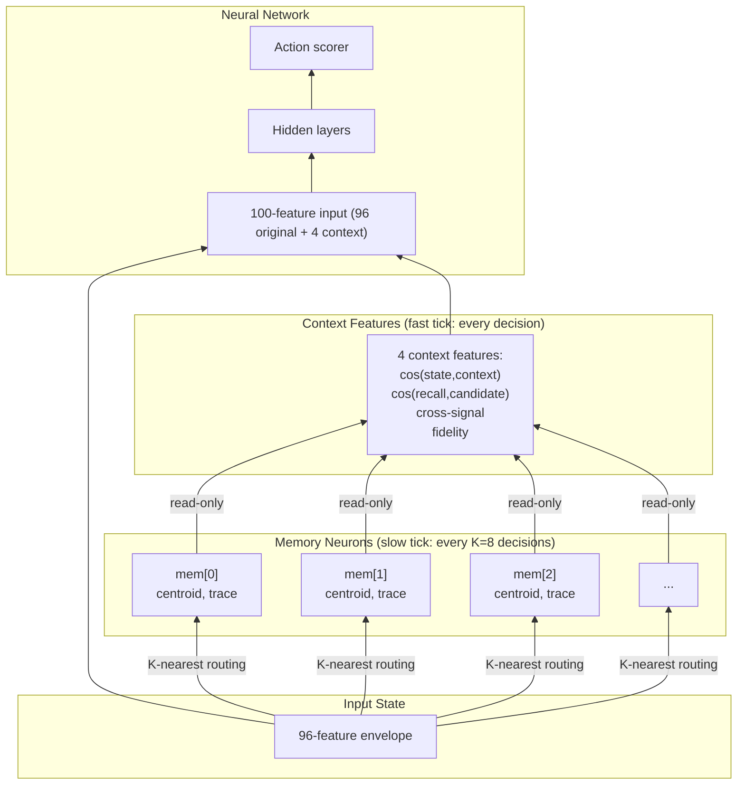
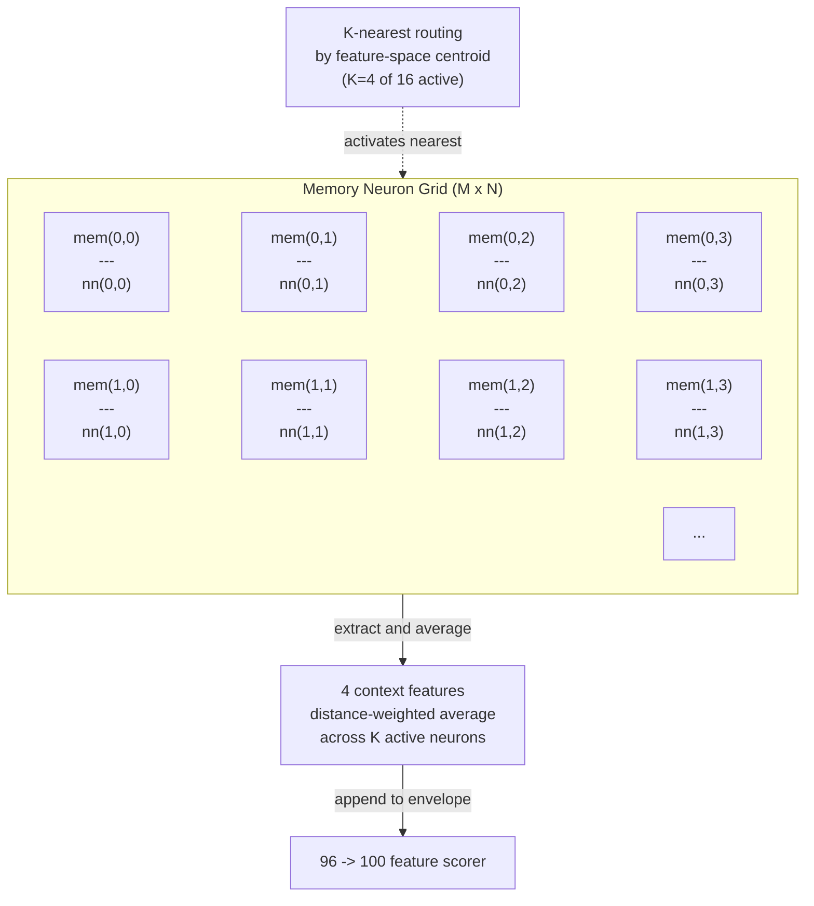
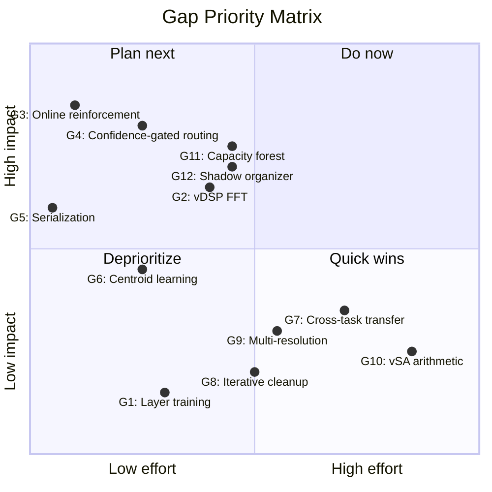
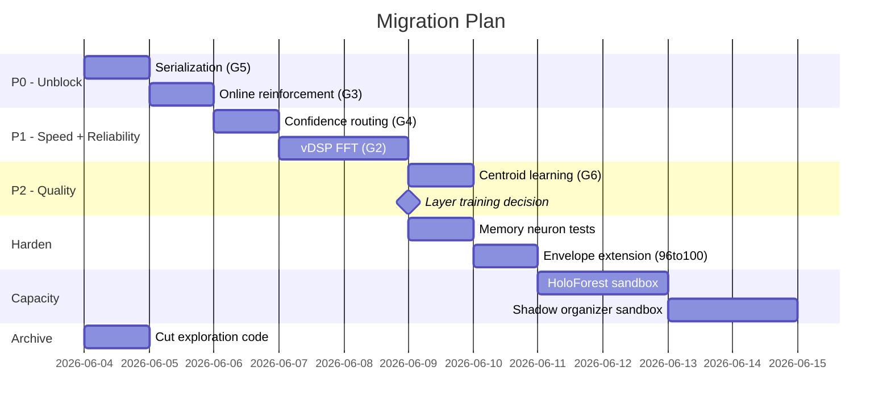

# HoloNet Retrospective & Memory Neuron Architecture

*June 2026 — from nine experiments through four abstraction layers to one
unified design. Updated 2026-06-10 after external VSA reference intake and ARC
trace-proposer measurements.*

---

## 1. Executive Summary

We ran nine experiments across four layers of abstraction, all pointing toward
the same conclusion: **holographic memory shouldn't replace neural networks —
it should augment them on a slower clock.**

The winning pattern is a memory neuron: a holographic trace that lives next to a
traditional neuron, accumulates verified experience on a slow tick, and feeds
context features into the neural forward pass on every fast tick. The neural net
learns through normal SGD whether and how to use those features. No post-hoc
blending, no separate architecture, no confidence gate.

This document captures every experiment finding, the architectural proposal it
supports, and exactly what code we keep, cut, or build. A later review of
`AnOversizedMooseWithSocks/holostuff` did not change the core conclusion, but
it sharpened the backlog: capacity partitioning and verifier-measured
self-organization should be first-class follow-up work. The reviewed repository
had no visible license file, so it is reference material only, not a dependency.

---

## 2. The Four-Layer Stack

**Layer 1** is the compute substrate — it stays. **Layer 2** is a full VSA-space
neural architecture that we deprecate because k-NN is the proven core and layer
training doesn't converge. **Layer 3** gets folded into the memory neuron grid.
**Layer 4** gets removed: HolographicRanker becomes the computation *inside*
each memory neuron, and HoloGate's post-hoc blending gets replaced by learned
feature weighting in SGD.

---

## 3. Experiment Lineage

Nine experiments, each answering one question and feeding the next.

The **claim_reform** experiment was the turning point: six encoding strategies
proved that raw continuous state fails because holographic memory needs states
in the same decision region to map to the same key. Bucketed or gate-aware
encoding works. This insight drove the entire memory neuron design.

---

## 4. What Each Experiment Taught

| Experiment | Question | Finding |
|---|---|---|
| `holo_ranker_demo` | Can holo k-NN replace the MLP? | Yes — on the right tasks. 0 params, graceful forgetting at 1/sqrt(N). |
| `holo_all_experiments` | Where does holo win and lose? | Dominates spatial/local tasks; struggles on logical/conditional — but it's an encoding problem, not an architecture problem. |
| `holo_claim_reform` | Why does holo fail at delayed claim? | **The key finding.** Six strategies tested. Bucketed-by-decision-region works. Gate-aware encoding works best. Holo needs states in the same decision region to map to same key. |
| `holo_envelope` | Can 4 universal holo features improve domain-specific MLP? | Yes. Tiny 4->8->4->1 MLP trained on nothing but holo scores achieves competitive accuracy across domains. |
| `holo_replace_envelope` | Can we replace domain features entirely? | Yes. domain_state -> uint64_t seed -> keygen(seed) -> vector. Zero domain knowledge. |
| `hybrid_holo_nn` | Each neuron as its own tiny holographic store? | Works. Each neuron binds(input_fragment, output_component) then bundles. Routing is naive (hash-based), though. |
| `holonet` | Sparse activation with feature-space routing? | 16 neurons, K=4 active, distance-weighted scoring. Natural specialization emerges. Right routing, but centroids are random. |
| `fully_holographic` | Entire network in VSA space? | Yes — memory recall -> layer -> classify. Graceful forgetting to 800 distractors. But it's a separate architecture, not integrated. |
| `gated_runner_demo` / `gated_all` | Blend holo + neural scores? | alpha = fidelity^3 auto-routes: pure holo at N=1, pure neural at N=100. But it's post-hoc glue — two independent systems averaged at the end. |
| `holographic_prime_gap` | Holo features for prime gap prediction? | 4 holo context + 14 static > 14 static alone. Cluster-based encoding is the right approach. |
| `cross_domain_big` | Shared memory, transfer, voids, scale? | Shared memory across 4 tasks works with modest interference. Voids are detectable. Scales to 10K frames at ~0 us/query. |

---

## 5. The Core Insight

> **Post-hoc blending is the wrong architecture.** You shouldn't run two
> independent systems and average their scores. The memory should feed
> context into the neural network so SGD itself learns the weighting.

This directly implies the memory neuron design:

**Fast tick** (every decision): Memory neurons are read-only. They provide 4
context features appended to the 96-feature envelope. The neural net forward
pass proceeds normally with these 100 features.

**Slow tick** (every K=8 decisions): After the verifier confirms a correct
action, the K nearest memory neurons store `bind(state, verified_action)` into
their holographic trace. Centroids drift toward stored states at lr=0.01.
Context features are recomputed for the next fast tick.

---

## 6. Proven Claims

These have been verified across multiple experiments:

1. **Holographic k-NN achieves 100% on local-continuity tasks** with zero
   parameters. Fidelity decays as 1/sqrt(N). Memory is O(dim) fixed.

2. **Flat-spectrum keygen produces perfect bind/unbind roundtrip.**
   `sim(v, unbind(bind(k,v), k)) = 1.000000` verified.

3. **Radix-2 FFT at ~10 GFLOPS, 3e-15 roundtrip error.** Self-contained,
   pre-computed twiddles, zero malloc in hot path.

4. **Memory fades gracefully — no catastrophic forgetting.** Accuracy holds at
   100% from 5 to 500 stored examples despite fidelity dropping from 0.45 to
   0.045.

5. **Neural scorer and holographic k-NN are complementary.** 84% vs 30.5% on
   delayed_claim (logical/discontinuous); 100% vs lower on grid_path
   (spatial/local).

6. **HoloNet with structured receptive fields matches flat k-NN** while
   distributing load across neurons through sparse activation.

7. **Zero-parameter architecture.** No weights to train, checkpoint, or
   serialize. The model IS the memory trace. Training IS storing examples.

---

## 7. The Memory Neuron Grid

### Optimal Default Configuration

| Parameter | Value | Reason |
|---|---|---|
| Grid dimensions (MxN) | 4x4 = 16 neurons | Matches holonet.c; enough for specialization, small enough for sparse activation |
| Active neurons (K) | 4 | 25% activation; distance-weighted scoring works at this ratio |
| VSA dimension | 2048 | Sweet spot from all experiments; 16KB per trace, good fidelity |
| Slow tick interval | 8 | Fast enough to accumulate signal, slow enough for stable context |
| Context features | 4 | Proven sufficient by holo_envelope.c |
| Centroid learning rate | 0.01 | Gentle online clustering |
| Total memory | 16 x 16KB = 256KB | Negligible |

---

## 7.1 Current Implementation Status

The memory-neuron grid is no longer only a proposal. The repo contains:

| Artifact | Status | Notes |
|---|---|---|
| `include/memory_neuron.h` | implemented API | grid lifecycle, fast context extraction, slow verified storage, diagnostics |
| `src/memory_neuron.c` | implemented prototype | feature-space centroids, K-nearest activation, per-neuron `HolographicRanker` traces |
| `examples/memory_neuron_demo.c` | implemented demo | compares base neural features against neural + 4 memory context features |
| `examples/holo_experiments.c` | implemented sandbox rows | includes memory-neuron routing JSONL used by paper-support diagnostics |

The next task is not "write `memory_neuron.c`"; it is to harden the
implementation: unit tests, deterministic row schemas, integration into real
ranker/eval loops, and capacity protection for hot cells.

---

## 8. The Four Context Features

From the CrlpBridge experiments, these four signals carry all the necessary
memory context:

| # | Feature | Formula | Meaning |
|---|---|---|---|
| 1 | State familiarity | `cos(state, holo_context(state))` | Has this region been seen before? |
| 2 | Candidate match | `cos(candidate, holo_recall_recent(state))` | Does this candidate match memory? |
| 3 | Cross-signal | `cos(holo_context(state), candidate)` | Alignment between context and candidate |
| 4 | Fidelity | `1 / sqrt(stored)` | How confident is this memory? |

These are extracted per active memory neuron and distance-weighted-averaged
across the K active ones before being appended to the scorer envelope. Since
they're just 4 additional input features, the neural net naturally learns to
weight them — no post-hoc blending, no confidence gate, no separate path.

`holostuff` reinforces the same principle from the other direction: its useful
mechanisms classify/recall/organize over a shared vector substrate, but the
adoption rule that fits this repo is still verifier measurement. Context
features may enter the scorer; correctness still comes from the grounding
operator.

---

## 8.1 Capacity and Self-Organization Intake

Two external patterns should be folded into this architecture:

| Pattern | Fit | Local backlog item |
|---|---|---|
| HoloTree/HoloForest | protects fixed-width traces from capacity collapse by routing to small leaf memories | implement a sandbox C `HoloForest` around `HolographicRanker`; compare flat/tree/forest recall and comparisons |
| Shadow self-organization | rebuilds candidate memories off to the side, judges them, then swaps | implement verifier-measured split/merge/rebuild for hypothesis or rejected-candidate memories |

Capacity partitioning is a better version of the old "multi-resolution memory"
gap. It should be measured before any long-running memory-neuron claim depends
on flat traces. Self-organization should not be threshold folklore; it should
emit rows showing held-out utility, memory size, false-rejection preservation,
and the adopted strategy.

---

## 9. Keep, Cut, Build

### Keep

| Artifact | Why |
|---|---|
| **LeosEngine** | Clean, fast, correct VSA compute substrate. The foundation. |
| **HolographicRanker** | Becomes the core computation inside each MemoryNeuron. |
| **memory_neuron.h / memory_neuron.c** | Already implemented as a prototype. Harden and integrate rather than rebuilding. |

### Cut

| Artifact | Reason |
|---|---|
| LeosHNN / fully_holographic.c | Separate VSA neural network — wrong direction. Memory should augment, not replace. |
| HoloGate / gated_all.c / gated_runner_demo.c | Post-hoc blending replaced by learned feature weighting in SGD. |
| HoloRunner, HoloExperiment, HoloGate | Experiment harnesses replaced by unified MemoryNeuron grid. |
| CrlpBridge / nn_holographic | Global singleton folded into memory neuron grid. |
| holonet.c, hybrid_holo_nn.c, holo_envelope.c, holo_replace_envelope.c, holo_claim_reform.c, holo_all_experiments.c | Exploration code; learnings captured in this document. |
| holographic_prime_gap.c, holographic_ranker_demo.c, cross_domain_big.c | Archive or rewrite against MemoryNeuron grid. |
| merge-holo script | Already untracked; future merge orchestration belongs in C runtime tools. |

### Build

| Artifact | Effort | What it does |
|---|---|---|
| Memory-neuron tests | ~0.5 day | Validate context extraction, slow-tick storage, counts, fidelity, and deterministic routing |
| Real-loop wiring | ~1 day | Store verified state/action pairs after the grounding operator confirms them |
| Envelope integration | ~1 day | Make 4 memory context features a declared scorer condition, not ad hoc demo rows |
| `HoloForest` sandbox | ~2 days | Capacity partitioning around `HolographicRanker`; flat/tree/forest ablation rows |
| Shadow organizer sandbox | ~2 days | Split/merge/rebuild memory candidates, judge on held-out verifier rows, adopt winner |

---

## 10. Gaps & Priority

| Priority | Gap | Effort | Impact |
|---|---|---|---|
| P0 | **G3: Task-conditioned ARC proposal learning** — continue from online `trace_task_prior` beating structural/global-trace at budget 64; trained `trace_linear`/`trace_mlp` trail it, so add confidence-gated residual heads around the prototype memory | 1d | Tests the proposal-coverage bottleneck exposed by the full-scale ranker probes without trusting the learner for correctness |
| P0 | **G3: Scale-space / visual-program coverage** — use learned proposal traces to choose the next family, then add only verifier-backed generic coverage | 1-2d | Keeps operator work tied to measured family/slot gaps |
| P0 | **G5: Serialization hardening** — add magic/version/dim checks to existing trace save/load | 30m | Safer checkpointing and model transfer |
| P1 | **G4: Confidence-gated routing** — blend alpha = fidelity; fall back to neural when fidelity < 0.1 | 1d | Combined holo+neural wins on all tasks |
| P1 | **G2: vDSP FFT** — replace hand-rolled FFT with Accelerate/FFTW | 2d | 3-5x throughput improvement |
| P2 | **G6: HoloNet centroid learning** — online k-means instead of random init | 1d | Better neuron utilization (currently 8/16 unused) |
| P2 | **G1: Accept k-NN as core** — deprecate layer training, ship what works | 0 | Removes dead-end research path |
| P2 | **G11: Capacity forest** — deterministic tree/forest of small holographic memories | 2d | Prevents flat-trace overload; gives recall/cost ablation rows |
| P2 | **G12: Shadow organizer** — split/merge/rebuild memories by held-out verifier utility | 2d | Keeps memories compact and adaptive without unmeasured thresholds |
| P3 | **G7: Cross-task transfer** — Rosetta projection or task-tagged keys | 3d | Knowledge sharing between domains |
| P3 | **G9: Multi-resolution memory** — pyramid of traces at dim/2, dim/4, dim/8 | 2d | Coarse-to-fine retrieval |
| P4 | **G8: Iterative cleanup** — non-normalized intermediate accumulator | 2d | Recover deeply buried memories |
| P4 | **G10: vSA arithmetic** — RNS encoding for exact integer ops in VSA space | 5d | Future research direction |

---

## 11. Migration Roadmap

1.  **Cut first.** Delete or archive all the exploration code listed in the cut
    table. This reduces the surface area by ~12 files and prevents confusion
    about which architecture is canonical.

2.  **Unblock.** Serialization (30 minutes) and online reinforcement (1 hour)
    are trivial to implement and immediately make the ranker usable.

3.  **Harden.** `memory_neuron.c` already exists. Add tests, wire it into the
    eval/train loop, and extend the scorer envelope with a declared condition.

4.  **Accelerate.** vDSP FFT and confidence-gated routing together give both
    speed and robustness.

5.  **Refine.** Centroid learning makes the sparse activation actually work
    (instead of leaving half the neurons idle with random centroids).

6.  **Partition capacity.** Add forest-backed memories as a sandbox ablation
    before claiming long-horizon memory-neuron stability.

7.  **Self-organize by measurement.** Add shadow split/merge/rebuild candidates
    only where held-out verifier or replay rows can judge the adoption.

8.  **Explore.** Cross-task transfer and multi-resolution memory are high-effort
    research directions; pursue only when the core architecture is stable.

---

## 12. Design Principles (Learned)

1.  **Memory should augment, not replace.** The holographic store is good at
    local-continuity recall; the neural net is good at discontinuous logical
    mappings. The right architecture feeds one into the other, not one instead
    of the other.

2.  **Encoding matters more than architecture.** The claim_reform experiment
    proved that raw continuous state vectors don't work for holographic memory
    because near-orthogonality in high dimensions means every state looks
    different. Bucketing states by decision region fixes this.

3.  **SGD learns weighting better than hand-tuned blending.** The confidence
    gate (alpha = fidelity^3) works, but it's a ceiling: two independent systems
    averaged at the end. Giving SGD those same signals as input features lets
    it discover more nuanced weightings.

4.  **Slow memory, fast network.** Memory updates on a slower clock (every K
    decisions) while the neural forward pass runs on every decision. This
    matches the biological pattern: memory consolidation is slower than
    perception/action.

5.  **Sparse activation with learned centroids beats dense or random.** The
    HoloNet experiment showed natural specialization when routing is
    distance-weighted, but random centroids leave half the neurons unused.

6.  **Zero parameters is a feature, not a limitation.** Training IS storing.
    The model IS the trace. Serialization is 2 lines of fwrite. This is a
    fundamentally different — and simpler — paradigm than SGD-trained weights.

7.  **Capacity is a measured resource.** Fixed-width memory is useful because it
    is bounded, not because it is infinite. When a trace overloads, partition it
    into measured leaves and report recall/cost rather than hiding the cliff.

8.  **Self-organization needs an adoption test.** Rebuilding a memory is only an
    improvement if held-out verifier or replay rows say so. Shadow-and-swap is
    the right mechanical pattern; verifier measurement is the right authority.
